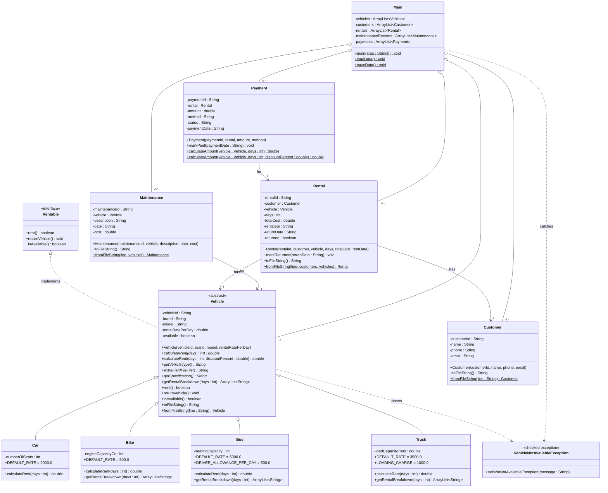

# UML Class Diagram

The diagram below reflects the classes that are **actually implemented** in the
`src` folder. It uses Mermaid syntax, which renders automatically in VS Code
(install a Markdown/Mermaid preview) and on GitHub.

---

## Reading the diagram

| Symbol | Meaning in this project |
|--------|-------------------------|
| `<<interface>>` | `Rentable` - only declares behaviour, no fields. |
| `<<abstract>>` | `Vehicle` - cannot be instantiated directly; has the abstract `calculateRent`. |
| `<|..` | Realisation: `Vehicle` implements `Rentable`. |
| `<|--` | Inheritance (generalisation): the four vehicle types extend `Vehicle`. |
| `-->` | Association: `Rental` holds a `Customer` and a `Vehicle`; `Payment` holds a `Rental`; `Maintenance` holds a `Vehicle`. |
| `o--` | Aggregation: `Main` owns the `ArrayList`s of records. |
| `..>` | Dependency: `Vehicle.rent()` throws, and `Main` catches, `VehicleNotAvailableException`. |
| `$` suffix | Static member (for example `Vehicle.fromFileString`). |

## Relationship summary

* **Inheritance (is-a):** `Car`, `Bike`, `Bus`, `Truck` are all `Vehicle`s.
* **Realisation:** `Vehicle` (and therefore all subclasses) is `Rentable`.
* **Composition / association (has-a):**
  * `Rental` -> `Customer` (the renter),
  * `Rental` -> `Vehicle` (the rented item),
  * `Payment` -> `Rental` (the rental being paid for),
  * `Maintenance` -> `Vehicle` (the vehicle being serviced).
* **Aggregation:** `Main` keeps `ArrayList` collections of all record types.
* **Dependency:** the custom `VehicleNotAvailableException` flows from
  `Vehicle.rent()` up to `Main`.
